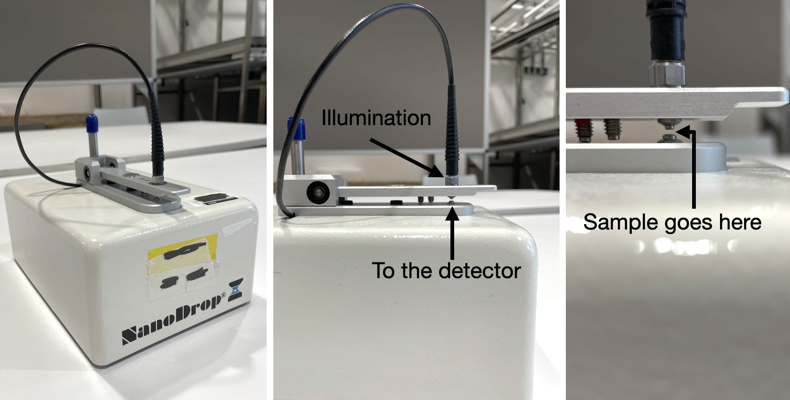
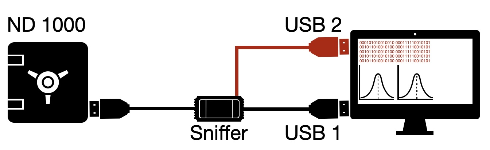

# Open TechEd: Revival of Legacy Teaching Instruments for Modern Education

**Bringing €200,000 of laboratory instruments back to life — a pilot on the Thermo Fisher NanoDrop 1000**

Jord van Leeuwen¹, Vincent de Boer², and Vittorio Saggiomo¹

¹ Department of BioNanoTechnology, Wageningen University & Research
² Department of Human and Animal Physiology, Wageningen University & Research

> **Reports:** [full technical report (DOCX)](reports/OSE_NanoDrop_Report.docx) · [one-page summary (DOCX)](reports/OSE_NanoDrop_One-Page.docx)

---

## Why we did this project

> *Your lab owns the hardware. The company owns the software. And when the software stops, the whole instrument stops.*

When a manufacturer declares an instrument "legacy", it stops updating the software that controls it. The hardware itself may still work perfectly, but it can no longer communicate with modern computers. The result is that working instruments get thrown away — not because they broke, but because the software that ran them was abandoned.

The scale of the problem is easy to underestimate. Take ten Thermo Fisher NanoDrop 1000 spectrophotometers bought in 2004 at roughly €20,000 each: that is an investment of about **€200,000**. The last software update for the instrument was released in **June 2011**, and from the release of **Windows 8** in October 2012 the device could no longer reliably communicate with modern operating systems. Only seven to eight years after purchase, a €200,000 investment had become unusable — purely because of software. The hardware kept working; only the permission to use it on a modern computer was gone.

This is not only a question of money. It touches four broader problems:

- **Subscriptions.** Software is increasingly rented rather than sold, keeping updates and forks under the vendor's control.
- **Digital sovereignty.** If the software must phone home, the vendor can lock the instrument remotely — regardless of who paid for it.
- **Interoperability.** Proprietary software keeps instruments out of automated workflows, which is a growing problem for self-driving laboratories.
- **Legacy instruments and e-waste.** Declaring an instrument "legacy" pushes laboratories to replace hardware that still works, sometimes forcing them to keep an unpatched Windows XP machine alive just to run it. In a **teaching** environment this is especially wasteful: universities buy many instruments for practicals and then have to discard them because the software is stranded.

Open-source software is mature and open-source hardware is growing, but the link between the two — software that lets you own and control your hardware — is still missing. **Open TechEd** is a pilot that links the two: pick up a legacy teaching instrument, reverse-engineer it, and give it an open, modern software stack.

The project was funded by the **WUR Open Science & Education programme** (grant no. OSE202534), so we focused on the legacy-instrument and e-waste angle — while addressing the other points along the way. Getting a complete list of legacy instruments from the *Practicum Facilitaire Ondersteuning* (PFO) proved impossible, but talking to them made one thing clear: the NanoDrop 1000 was an instrument they used to use and can no longer run. We also had a couple of them lying around, so the pilot chose itself.

## The instrument: a "retired" NanoDrop 1000

The **Thermo Fisher NanoDrop 1000 (ND-1000)** is a full-spectrum UV-Vis microvolume spectrophotometer, introduced in 2001 by NanoDrop Technologies (later acquired by Thermo Fisher Scientific). It measures a **1–2 µL** sample directly on a fiber-optic surface, held in place by surface tension — no cuvettes, no dilution, and a full spectrum in about ten seconds.

- **Range:** 220–750 nm; xenon flash lamp; 2048-element linear CCD; no moving parts; ±1 nm wavelength accuracy.
- **Dynamic range:** two path lengths (2 mm and 0.2 mm) are used automatically within each measurement, covering roughly 2–3,700 ng/µL of dsDNA without dilution.
- **Use:** quantifying DNA/RNA (A260/A280), proteins (A280, Bradford, BCA, Lowry), dye labelling, and general UV-Vis work.

The instrument is controlled from a Windows PC over USB by the *NanoDrop 1000 Operating Software* (v3.8.1, last released June 2011). Officially it runs only on Windows XP, Vista, and Windows 7 — precisely the "legacy" situation described above. Yet the hardware is simple, well documented, and still fully functional, which makes it an ideal candidate for reverse engineering. Under the hood, the optical core is a **modified OEM Ocean Optics USB2000** spectrometer.

## What we did

We picked one "retired" NanoDrop 1000, analysed the data it sends over USB, reverse-engineered its undocumented communication protocol, and wrote our own open-source Python software to control it. That software was then integrated into **[PyLabRobot](https://github.com/PyLabRobot/pylabrobot)**, an open-source, pure-Python SDK for laboratory automation that is hardware- and operating-system-agnostic.

The reverse engineering was black-box: we ran the original vendor software on Windows 7 and recorded the USB traffic, first with a Beagle USB 12 protocol analyser and then with **Wireshark**. From the packet captures, cross-referenced with the Ocean Optics USB2000 documentation, we reconstructed the full control path:

- **Mailboxes:** endpoint `0x02` for commands, `0x87` for text/status, and `0x82` for the raw image data.
- **Wavelength calibration:** the factory-set 3rd-order polynomial coefficients are read directly from the spectrometer EEPROM (the 7th-order non-linearity correction is also downloaded in the PyLabRobot driver).
- **Pixel decoding:** the 12-bit ADC values are transmitted as interleaved LSB/MSB blocks and rebuilt with `intensity = (MSB << 8) | LSB`.
- **Xenon lamp:** command `0x03`, the Ocean Optics "set strobe enable" command reused by Thermo Fisher.
- **Solenoid clamp:** command `0x0F`, proprietary Thermo Fisher hardware that is *not* in the Ocean Optics command set and had to be identified purely by sniffing.
- **Modern Windows:** a BOS-descriptor registry fix plus the open `libusb-win32` driver (installed with Zadig) allow the device to run on Windows 10/11 — and the same PyUSB backend works on macOS and Linux.

   
  <em><strong>Figure 1.</strong> The Thermo Fisher NanoDrop 1000, and the highlight of its detection zone.</em>

   
  <em><strong>Figure 2.</strong> Standard scheme of a USB "sniffer": while the standard program is used to control the instrument via USB 1, at the same time USB 2 is used to record the USB traffic, which is later used to decode which command does what on the instrument. USB 2 may be connected to a different computer than the one the software is running on.</em>

## The outcome

The pilot worked. The revived NanoDrop 1000 is now a fully usable, open piece of laboratory equipment:

- **It runs on Windows, macOS, and Linux.** The driver is OS-agnostic and needs no vendor license, no subscription, and no vendor key — just Python and an open USB driver.
- **It is part of PyLabRobot.** The driver was contributed upstream and merged in [PyLabRobot PR #1166](https://github.com/PyLabRobot/pylabrobot/pull/1166) (September 2026), so the instrument can be orchestrated together with other laboratory hardware.
- **It was validated on real measurements.** The measured xenon flash-lamp spectrum closely matches the reference spectrum from the literature (characteristic UV peaks, the sharp triplet-like structure around 490 nm, and the features near 540 nm and in the red/IR). The instrument then correctly detected **paracetamol in water**, resolving its strong UV band at λmax ≈ 243 nm after blank subtraction, scan averaging, and smoothing.
- **It exposed and fixed real platform issues.** Testing on macOS surfaced a `clear_halt` crash and a lamp that would not always switch off; both were fixed (best-effort `clear_halt`, USB reset at teardown) and hardware-verified.

The demonstration — with the blank measurement, the 1× vs 10× averaged absorbance, the boxcar vs Savitzky–Golay comparison, and the archived measurement arrays — is preserved in [`demonstration/`](demonstration/).

**Why this matters.** Instead of replacing working hardware, we extend its life at almost zero cost: a free and open piece of software replaces the outdated package that made a €20,000 instrument unusable and a €200,000 fleet investment worthless. The university regains full ownership of both the instrument and its data, the hardware stays out of the waste stream, and the instrument can join modern automated workflows. This pilot proves the approach on one real instrument; scaling it to the many other "legacy" instruments across WUR turns old, unused assets back into usable ones — saving money, cutting e-waste, and giving the university full control of its own equipment.

## Repository guide

| Folder | What is inside |
|---|---|
| [`reports/`](reports/) | The two project reports: the [full technical report](reports/OSE_NanoDrop_Report.docx) and the [one-page summary](reports/OSE_NanoDrop_One-Page.docx). |
| [`initial-script/`](initial-script/) | The first working Python driver for the ND-1000 — pure `PyUSB` code (`nanodrop.py`, `main.py`), the exploration notebook, the Windows installation fixes, and the early PyLabRobot prototype kept for provenance. Adapted from [Jordvl/Pylabrobot-Open-science-ND1000](https://github.com/Jordvl/Pylabrobot-Open-science-ND1000/tree/main/Code). |
| [`demonstration/`](demonstration/) | The PyLabRobot demonstration: real measured data, all plots, the measurement walk-through, and the macOS fix write-up. |
| [`assets/figures/`](assets/figures/) | Figures 1 and 2 from the report, used on this page. |

## Links to the project

- **Demonstration repository:** [vcjdeboer/nanodrop-pylabrobot-demo](https://github.com/vcjdeboer/nanodrop-pylabrobot-demo)
- **PyLabRobot pull request (merged):** [PyLabRobot/pylabrobot#1166](https://github.com/PyLabRobot/pylabrobot/pull/1166) (Jordvl, refactored by Rick Wierenga)
- **Initial reverse-engineering code:** [Jordvl/Pylabrobot-Open-science-ND1000](https://github.com/Jordvl/Pylabrobot-Open-science-ND1000)
- **Zenodo raw data archive:** [10.5281/zenodo.22695032](https://doi.org/10.5281/zenodo.22695032)

## Cite this work

If you use this project, please cite it using the metadata in [`CITATION.cff`](CITATION.cff):

> van Leeuwen, J., de Boer, V., & Saggiomo, V. (2026). *Open TechEd: Revival of Legacy Teaching Instruments for Modern Education*. Wageningen University & Research. https://github.com/Vsaggiomo/open-teched-nanodrop

## Funding

This work was supported by the **WUR Open Science & Education programme** (grant no. **OSE202534**).

## License

[MIT](LICENSE) © 2026 Vincent de Boer, Jord van Leeuwen, and Vittorio Saggiomo.
